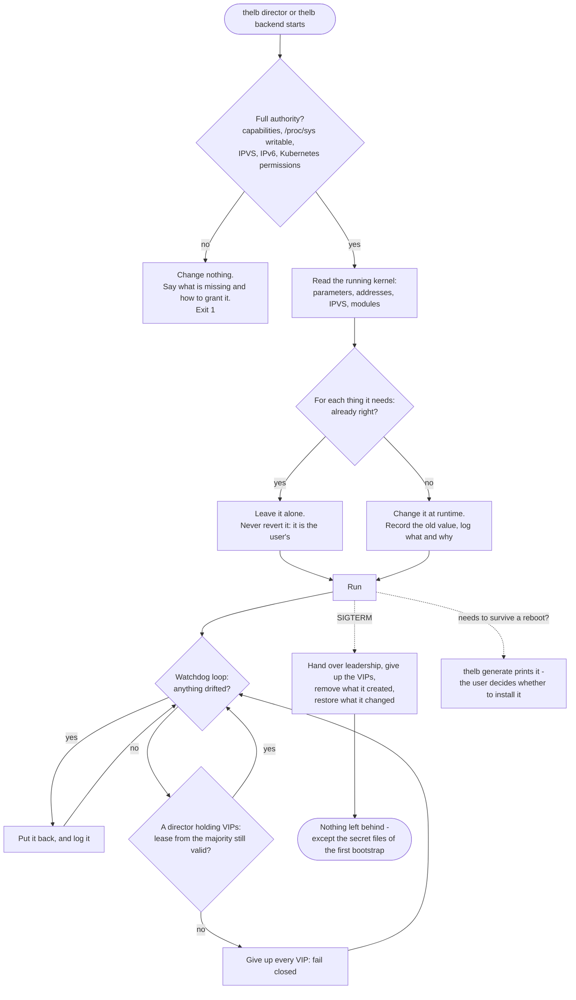
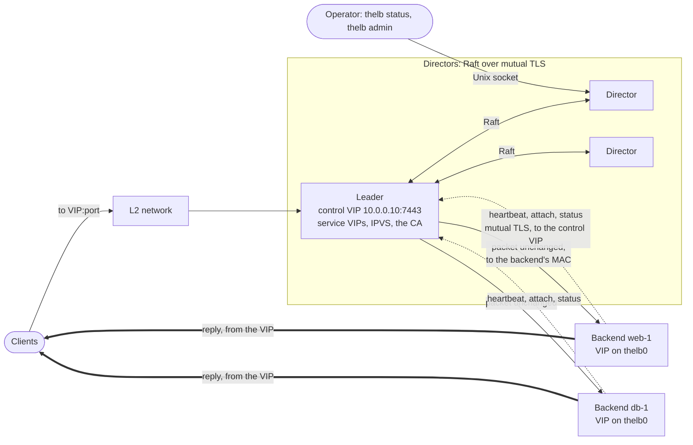
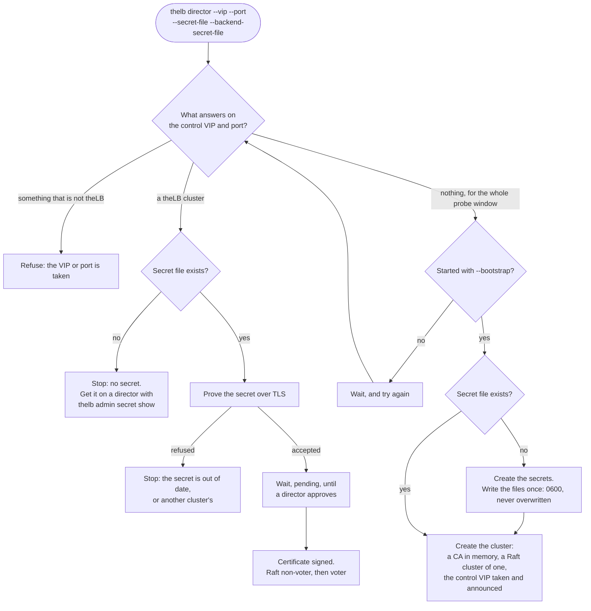
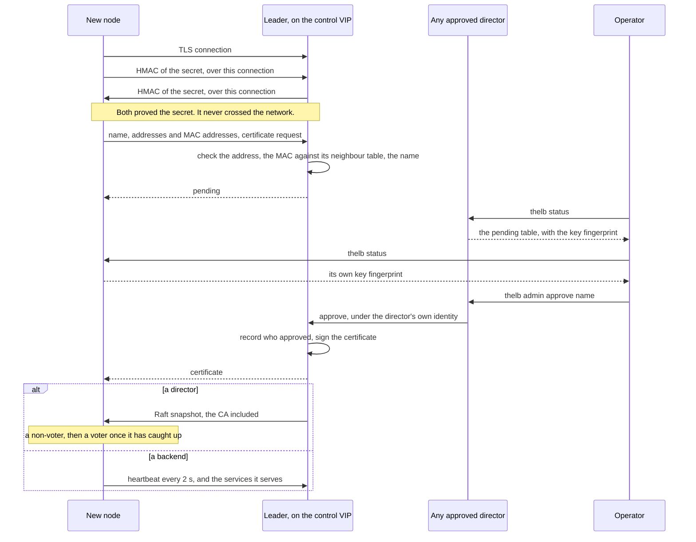
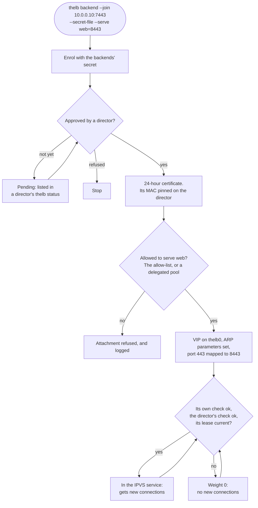
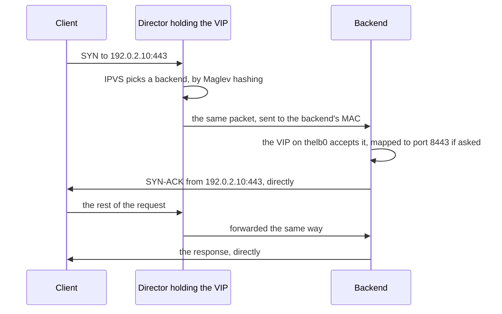

# Diagrams

The [philosophy](philosophy.md) and the [design](design.md) in pictures. Each diagram is a summary; where it and the text disagree, the text is right.

## 1. How theLB treats a machine

The philosophy, as one flow: full authority or nothing, the running kernel as the truth, fail closed, and nothing left behind.

## 2. The pieces

Directors form the Raft cluster; the leader holds the control VIP and the service VIPs. Backends are clients of the leader, never Raft members. Replies go from the backends straight to the clients.

## 3. Starting a director

The same command on every director. What it does depends on its secret file and on what answers on the control VIP.

## 4. Joining, and approval

A director and a backend join the same way; only what follows the approval differs.

## 5. A backend, from enrolment to traffic

## 6. A packet

Direct return: the director sees only the client's side of the conversation.

